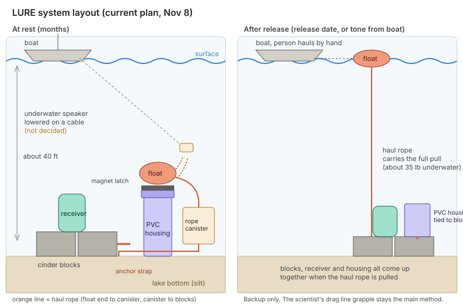

# LURE: Lake Underwater Release Engine

**A low-cost backup release that brings acoustic receivers up from the lake bottom.**

LURE is an open design from the Coding Curators, a FIRST LEGO League team, for the BIOGLOW season. A scientist told us how hard it is to get acoustic receivers back out of a lake after months on the bottom. Commercial releases work, but they cost about $4,000 more per receiver. We wanted something any team or lab could build for a small fraction of that.

> **Status: prototype in progress.** The sleep, wake and tone detection code works on the bench. The magnet, housing and underwater tests are still ahead. See [what is proven](#status) below. LURE is a **backup**, not a replacement for your normal retrieval method.

## The problem

- Receivers sit on the bottom for months to track fish like sturgeon.
- Getting them back means fighting depth, ice, boat traffic, mussel fouling and silt.
- Today many teams use a drag line grapple. A typical team recovers nearly all receivers each year but still loses a few percent.
- Commercial acoustic releases are about $6,000, compared to about $2,000 for the same kind of receiver without one (figures from Dr. Brandon Gerig, UW-Milwaukee).

## How LURE works

1. **Arm it.** Set a wake date and power it on.
2. **Sleep.** A DS3231 clock keeps time while the Arduino draws almost nothing.
3. **Wake and listen.** On the wake date, a piezo disc listens for one coded tone. It only counts the tone if it is loud and pure enough, several times in a row, so motors, waves and voices should not trigger it.
4. **Release.** On the tone, a MOSFET powers a hold magnet. The magnet holds with no power and lets go when powered, so the battery only has to run the clock while waiting.
5. **Haul.** A marker float carries a haul rope to the surface. A person in a boat hauls the receiver up by hand.

We started with a burn wire release. It would not cut the line consistently in cold water, so we switched to the hold magnet. The full story is in the [design doc](design-doc.md).

## Estimated cost

| | Per unit |
|---|---|
| LURE (our estimate, depends on rope) | about $137 to $159 |
| Commercial receiver without release | about $2,000 |
| Commercial receiver with release | about $6,000 |

LURE's number is an estimate, not a final cost.

## Status

| Part | Status |
|---|---|
| Sleep, wake on clock alarm, tone detection (Arduino Nano, desk) | Works on the bench |
| Piezo bias circuit, strong signal in contact with a speaker | Works on the bench |
| Piezo in water and through the PVC end cap | Not tested yet |
| APW 32 mm hold magnet on the battery pack | Not tested yet |
| PVC housing at 40 ft | Not tested yet |
| Idle current on a 3.3V Pro Mini | Not tested yet |
| Boat-side transducer (the lab already has one), range and tone coding | Not tested yet |

## Build one

Start with the **[build guide](BUILD-GUIDE.md)**. It covers parts, Arduino setup, wiring, tests, arming, the housing, and deploying.

## Firmware

`Main.ino` runs on an Arduino Nano for bench work and a 3.3V Pro Mini for the sealed build. It sleeps on a DS3231 alarm, listens on a piezo for a 1000 Hz tone with a Goertzel filter, then drives a MOSFET to fire the release. The git history has every earlier version of the sketch, oldest first.

## Diagrams

Open [`viewer.html`](viewer.html) in a browser for a tabbed view, or use the SVGs directly.

| Diagram | |
|---|---|
| [System layout](diagrams/system-layout.svg) | At rest and after release |
| [Electronics wiring](diagrams/electronics-wiring.svg) | Clock, MOSFET, hold magnet, piezo bias |
| [PVC housing section](diagrams/pvc-housing-section.svg) | How the parts sit in the pipe |

## What is in this repo

| Path | What it is |
|---|---|
| `Main.ino` | The firmware |
| `BUILD-GUIDE.md` | Step by step build and test guide (sealed build) |
| `design-doc.md` | Full design: options, what we tried, open questions, tests, safety |
| `research/presentation-prep.md` | Resources, papers and talking points |
| `diagrams/` | SVG diagrams |
| `viewer.html` | Tabbed viewer for the diagrams |
| `tools/build_viewer.py` | Rebuilds `viewer.html` (`python3 tools/build_viewer.py`) |

The older diagrams (LED and breadboard wiring, burn wire, retrieval stack) are still only in our original Claude chats.

## Safety

Adults handle all powered tests. Strong magnets can pinch badly and can interfere with phones and medical devices. Always fuse the battery pack. A housing can implode if it fails under pressure, so test it on a rope with people clear. Read the safety section in the [build guide](BUILD-GUIDE.md) before building.

## Thanks

Dr. Brandon Gerig and the School of Freshwater Sciences at UW-Milwaukee for the real-world numbers and encouragement, and the scientist whose retrieval problem started this project.
